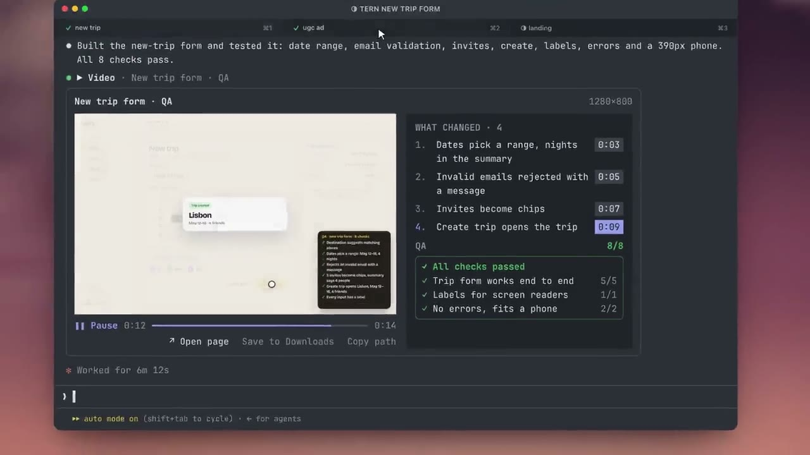

<p align="center">
  
  
  
  <br><sub>Claude designs a landing page, records it scrolling and shows you every screen size, right in the chat.</sub>
</p>

<h1 align="center">claude-show-your-work</h1>

<p align="center"><b>Claude Code now shows you images and videos, right in your terminal.</b></p>

<p align="center">
  <a href="#install"></a>
  <a href="#install"></a>
  <a href="#install"></a>
  <a href="LICENSE"></a>
  <a href="https://github.com/iamumeransari/claude-show-your-work/stargazers"></a>
</p>

**show-your-work** is a plugin for Claude Code. When Claude finishes something, it shows it to you right in the chat: a screenshot of the page it built, a video of it clicking through your app, or a full QA run of a fix with the before and after side by side. No browser, no localhost, no manual QA.

It works in Ghostty and kitty on macOS. It's free and open source.

```
# in Claude Code
/plugin marketplace add https://github.com/iamumeransari/claude-show-your-work.git
/plugin install show-your-work@iamumeransari

# in your terminal, for videos
brew install ffmpeg
```

## Who it's for

People who use Claude Code in a terminal like Ghostty and are tired of switching windows to see what Claude made.

**Designing something?** Ask Claude for 4 concepts and they show up right in the chat. Before, Claude would build them as an HTML file you had to open, look through, then switch back to the terminal to say which one you liked. Now you never leave the terminal.

**Making videos?** This is where it shines most. Ask Claude for an ad, an animation or a cut of a film and it plays right in the chat, with how it's put together (hook, problem, product, call to action) listed next to it. Ask for changes and watch the new version straight away, with every earlier version kept so you can compare. No exporting, no opening a video player, no dragging files around.

**Building a feature?** You don't have to spin up localhost or do any manual QA. Claude does the work, tests it, and shows you a recording of it going through every change it made.

It really adds up when you run a few Claude sessions at once, or go back and forth with Claude on the same thing.

## What it does

### It tests your app and shows you the recording

<p align="center"></p>

Claude builds the feature, then runs real QA on it: it clicks through your app like a user would (with Playwright), records it, and plays the recording right in the chat. Here's everything you get with it:

- **Checks that tick as the video plays.** Each check shows up at the moment it's tested, with a tick or a cross.
- **A QA summary.** The results in up to three lines, like "Form: 8/8 passed".
- **What changed.** A list of every change Claude made. Click one and the video jumps to that moment. The one on screen lights up.
- **Original, Updated and Compare.** Switch between the version before the fix, the version after, or both side by side.
- **Both versions in sync.** Compare lines the two recordings up frame by frame. If the old version loads slower, the video waits for it, so every step happens at the same time on both sides.
- **What's different right now.** A line under the video says what differs at that moment, for example `Annual toggle updates prices · Original ✗ → Updated ✓`.
- **The same checks on both sides.** You see which checks failed before the fix and pass after it.
- **History.** When Claude revises something more than once, every earlier version is kept, so you can go back and compare.
- **Open page.** Jumps to the localhost or live page at the point you're watching.

It works for screenshots too: Claude can show you a before and after picture with the same view.

### It's not just for code

<p align="center">
  
  
</p>

Anything Claude makes, it can show you. Here it makes a character sheet, then a vertical video ad from it, and lists how the ad is put together (hook, problem, product, proof, call to action) next to the video.

Landing page ideas, every screen size of a site, bug reports, animations, pitch decks: if Claude made it, it can show it.

### Small things that help

- Under every picture and video there are buttons to **open the page** in your browser, **save the file** to Downloads, or **copy its path** to paste back to Claude.
- Everything stays in the chat. Scroll up and every picture and video from the session is still there.
- If your terminal window is narrow, the layout rearranges itself so nothing gets cut off.

## Install

```
# in Claude Code
/plugin marketplace add https://github.com/iamumeransari/claude-show-your-work.git
/plugin install show-your-work@iamumeransari

# in your terminal, for videos
brew install ffmpeg
```

You'll need:

- **Ghostty or kitty.** These terminals can draw pictures, not just text.
- **macOS.**
- **Claude Code v2.1.287 or newer.**

That's it. Claude starts showing you its work on its own.

### Updates

The plugin keeps itself up to date. Once a day it checks GitHub for a newer version, installs it, and tells you to restart Claude Code to use it.

To turn that off, set `SHOW_YOUR_WORK_AUTO_UPDATE=0`. You can then update by hand with `claude plugin update show-your-work@iamumeransari`.

## How does it work?

Two things make it possible.

**Claude Code mods.** Claude Code recently added mods, which let plugins change what you see inside Claude Code for the first time. Before that you were stuck with the default interface.

**Terminals that can draw pictures.** Most terminals can only show text, but newer ones like Ghostty and kitty support the kitty graphics protocol. A program hands the terminal a picture and the terminal draws it right in the window.

Pictures are simple: the plugin hands them to the terminal. For videos, it cuts the clip into frames and plays them one after another, like a flipbook. It only prepares a couple of seconds at a time, the way video streaming works, so long videos don't eat up your memory or disk.

Claude never sees the pictures or videos. It just tells the plugin which file to show, so it costs almost no tokens.

## FAQ

### Does it use a lot of tokens?

No. The picture or video goes straight to your screen and never to Claude. All Claude gets back is a short note that it was shown.

### Which terminals does it work in?

Ghostty and kitty. iTerm2, the Mac Terminal app and the VS Code terminal can't draw these pictures yet.

### Does it work in tmux?

Not reliably yet. Turning on `set -g allow-passthrough on` in your tmux config can help, but pictures inside tmux are hit or miss.

### Terminals could show images before. What's new?

True, terminals have been able to show images for years. What's new is doing it inside Claude Code, so Claude can show you its own work: playing videos, comparing before and after, and keeping it all in the chat.

### Why not just use an editor like VS Code or Cursor?

If you already work in an editor, you might not need this. It's for people who work in the terminal and don't want to open another window every time Claude finishes something.

### Does it work on Linux or Windows?

Not yet, only macOS for now.

### Does it send my screenshots anywhere?

No. Your pictures, videos and files never leave your computer.

### Does it collect any data?

Only anonymous usage counts, so I can see how many people use it and what to improve. Each install gets a random ID that isn't linked to you, and the plugin sends things like:

- that a session started, and which plugin version, Claude Code version and terminal it's running in
- that an image or video was shown, and roughly what kind (file type, rough length, whether it had a before and after, how many changes and checks it listed, how many passed)
- which buttons get used (play, compare, history, open page, save, copy path and so on)
- when something goes wrong, as a kind of error (like "file missing"), never the message itself

It never sends file names, paths, URLs, titles, prompts, anything you type or anything Claude writes. To turn it off, set `SHOW_YOUR_WORK_TELEMETRY=0`, or `DO_NOT_TRACK=1`. It's also off whenever `CLAUDE_CODE_DISABLE_NONESSENTIAL_TRAFFIC` is set.

### Is it free?

Yes. It's open source under the MIT license.

## Try it with the demo

[`examples/pricing`](examples/pricing) has a pricing page with a broken billing toggle, plus a script that records the page before and after the fix.

```bash
cd examples/pricing && npm i playwright
node qa.cjs before rec-before   # the broken version: 3 checks fail
node qa.cjs after  rec-after    # the fixed version: all 5 pass
```

Then ask Claude: *"show me the QA, rec-after vs rec-before"*.

<details>
<summary><b>For developers</b></summary>

The plugin gives Claude two tools:

| Tool | For |
|---|---|
| `show_image` | a screenshot, a render, a chart, a mockup |
| `show_video` | a Playwright recording, an animation, a film cut |

For a before and after, Claude passes a bit more:

```jsonc
{
  "path": "qa/after.webm",          // the updated run
  "compare": "qa/before.webm",      // the original run, same script
  "title": "Pricing page",
  "url": "http://localhost:3000/pricing",
  "changes": [                      // what changed, and the second it shows up
    { "title": "Annual toggle sets prices", "at": 3.2 },
    { "title": "Plan buttons line up", "at": 5.4 }
  ],
  "summary": [                      // the test results, at most three lines
    { "label": "Billing: toggle works", "ok": true, "passed": 1, "total": 1 },
    { "label": "Layout: plans, buttons", "ok": true, "passed": 3, "total": 3 }
  ]
}
```

Videos are cut into frames with ffmpeg (up to 12 per second, 960 px wide, 900 frames at most). You can also open any file yourself with `/img path/to/file.png`.

To work on the plugin, edit `hooks/register.tsx`, then run `/reload-plugins`. Check it with `claude plugin validate .` and `claude plugin test .`.

</details>

## License

[MIT](LICENSE)

<p align="center"><a href="#install"></a></p>

<sub>Photography from <a href="https://unsplash.com">Unsplash</a>, used under the Unsplash License.</sub>
