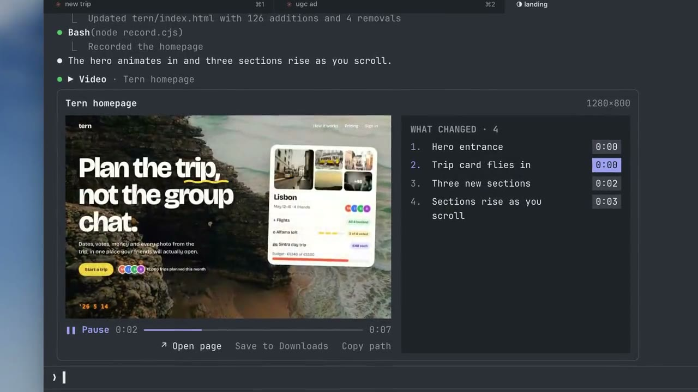
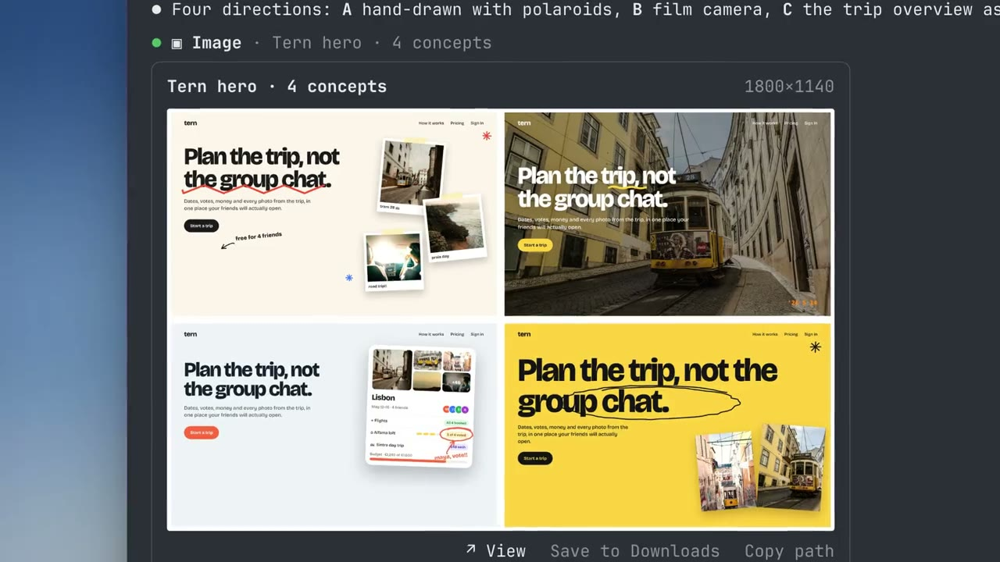
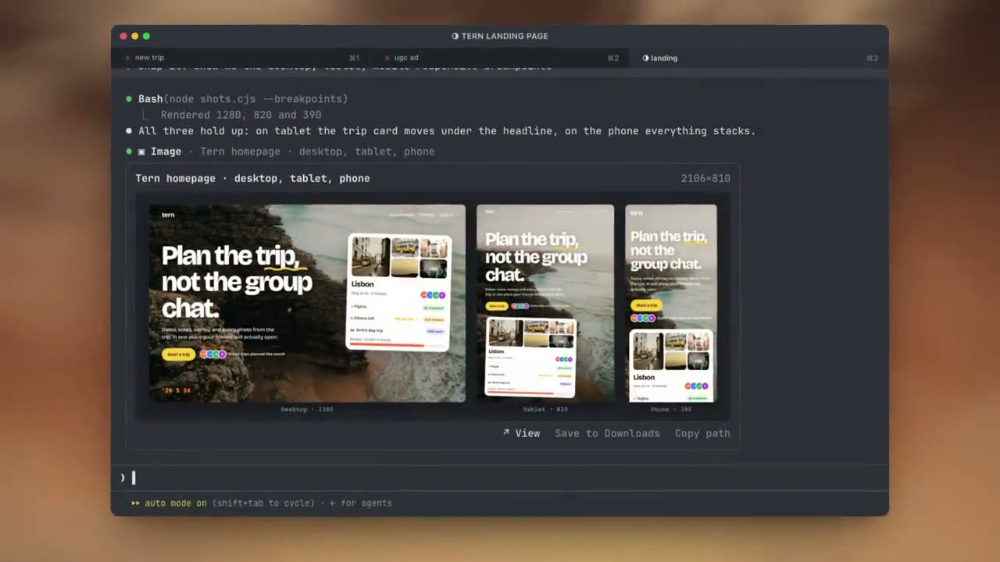
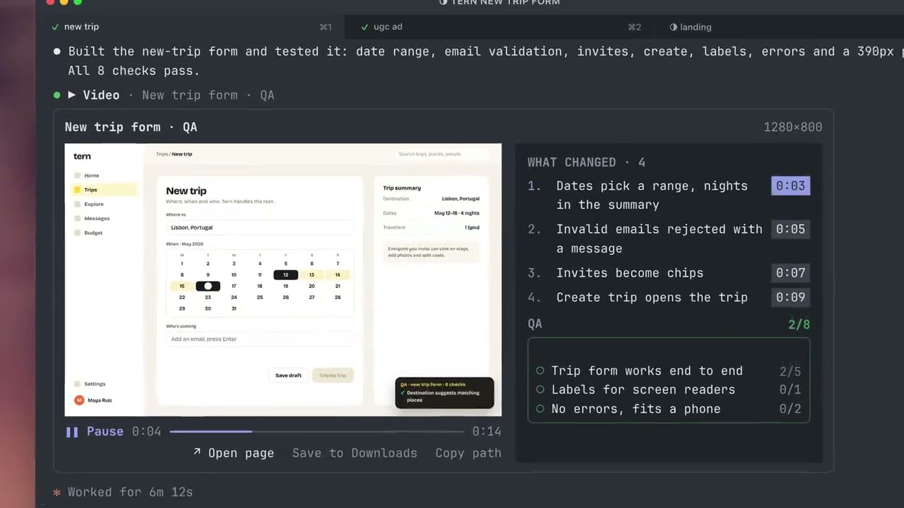
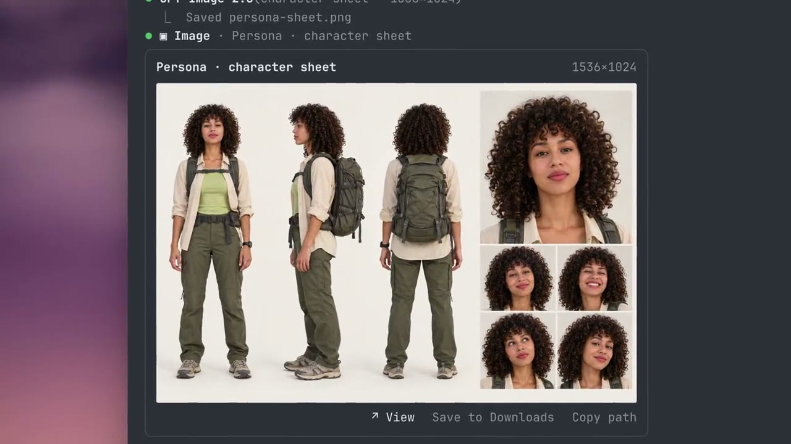
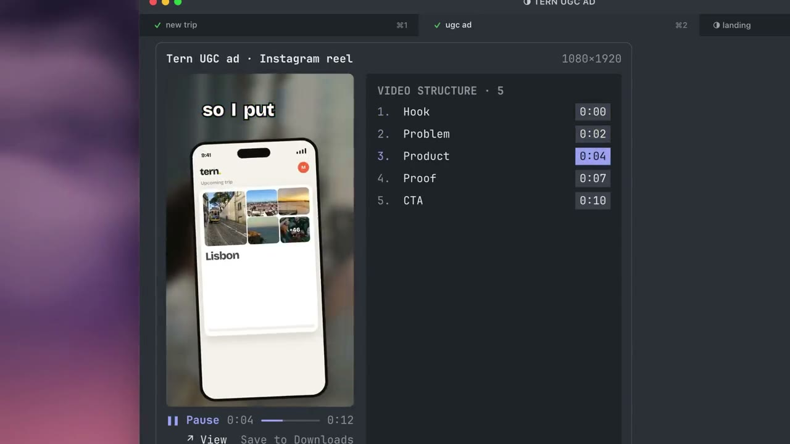
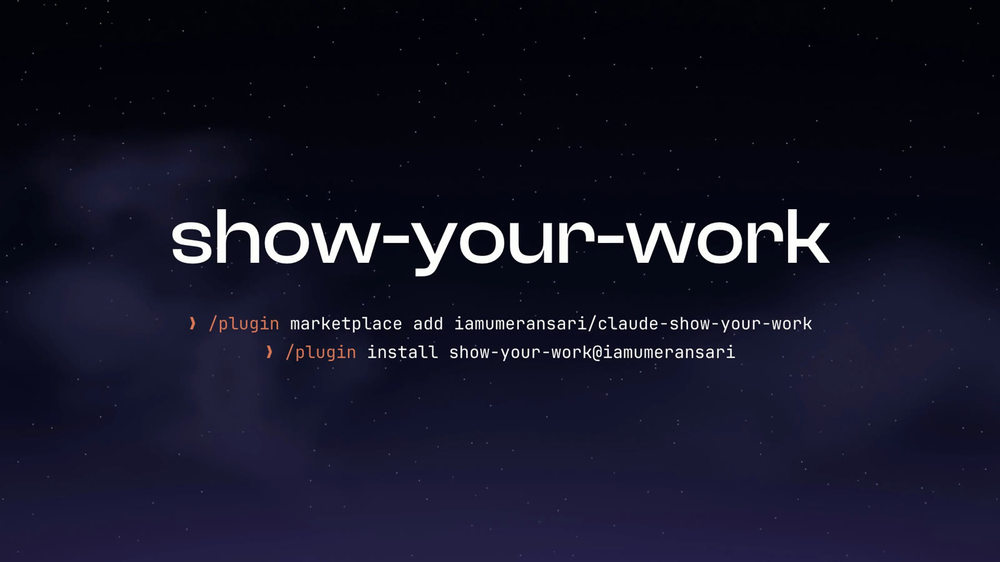

<p align="center">
  
</p>

<h1 align="center">claude-show-your-work</h1>

<p align="center">Claude Code can show you pictures and play videos in the terminal.</p>

<p align="center">
  <a href="#install"></a>
  <a href="#install"></a>
  <a href="#install"></a>
  <a href="LICENSE"></a>
</p>

claude-show-your-work is a plugin for Claude Code that lets Claude show you what it has made directly in the chat. That includes web pages, design concepts, charts, slides, generated images and videos. Claude can also record your app while it tests it, and play a fixed version next to the version from before the fix.

## Install

Run these two commands inside Claude Code:

```
/plugin marketplace add https://github.com/iamumeransari/claude-show-your-work.git
/plugin install show-your-work@iamumeransari
```

The plugin needs macOS, Claude Code 2.1.287 or later, and the Ghostty terminal, which is able to draw pictures. To play videos you also need ffmpeg, which you can install with `brew install ffmpeg` or by asking Claude to install it for you. Once that's done, there is nothing else to set up.

## Designs

<p align="center">
  
  
</p>

## Testing

<p align="center"></p>

Claude can test a feature by clicking through it with Playwright, recording the run, and playing the recording in the chat. Each change Claude made is listed beside the video, and clicking one jumps to the moment it appears.

When Claude fixes a bug, it can record the same steps on the old version and the new one. Compare plays the two recordings side by side and keeps them in sync, with the results of Claude's checks shown for each version.

## Video and images

<p align="center">
  
  
</p>

## When something can't be shown

If Claude tries to show a file and it doesn't work, you see a short note in its place that explains what went wrong. The file might be missing, it might not be a picture, the video might be damaged or have no picture in it, ffmpeg might not be installed, or your terminal might not be able to draw pictures. Each note has a button that copies a prompt, which you can paste back to Claude so it can fix the problem.

## How it works

Claude Code supports mods, which let a plugin draw its own interface inside Claude Code. Ghostty can display pictures inside the terminal window. When Claude wants to show you something, it tells the plugin which file to use, and the plugin passes that file to the terminal to draw.

Videos are split into frames with ffmpeg and played back in order. The plugin only prepares a couple of seconds of frames at a time, so long videos don't use much memory or disk space.

Claude never sees the picture or video itself. It goes straight to your screen, so Claude doesn't spend any tokens looking at it.

## Terminals

The plugin works in Ghostty. Other terminals, including iTerm2, Terminal.app and the VS Code terminal, can't draw these pictures yet, and the plugin tells you when that's the case.

It also works inside tmux, as long as you add `set -g allow-passthrough on` to your `~/.tmux.conf` file. If that setting is off, the plugin tells you how to turn it on.

## Updates

Each time you start Claude Code, the plugin checks GitHub for a newer version, at most once a day. If it finds one, it installs it and asks you to restart Claude Code. To turn this off, set `SHOW_YOUR_WORK_AUTO_UPDATE=0`. You can then update by hand with `claude plugin update show-your-work@iamumeransari`.

## Your data

Your pictures, videos and files never leave your computer.

The plugin does send anonymous usage statistics, so that I can see how many people use it and what goes wrong. Each install gets a random ID that isn't connected to you, along with a profile of the setup it runs on: the plugin version, the Claude Code version, the terminal, the operating system, and whether ffmpeg is installed. The plugin reports when a session starts, along with the plugin version, the Claude Code version and the terminal. It reports when a picture or video is shown, along with the file type, the length of a video, whether there was a before and after, and how many changes and checks were listed and passed. It also reports which buttons are pressed, and the type of any error, such as "file missing".

It never sends file names, paths, URLs, titles, prompts, or anything that you or Claude write. To turn it off, set `SHOW_YOUR_WORK_TELEMETRY=0` or `DO_NOT_TRACK=1`. It is also turned off whenever `CLAUDE_CODE_DISABLE_NONESSENTIAL_TRAFFIC` is set.

## Feedback

If you find a bug or have a question or an idea, please [open an issue](https://github.com/iamumeransari/claude-show-your-work/issues).

<details>
<summary><b>For developers</b></summary>

The plugin gives Claude two tools, `show_image` and `show_video`. A plain call is just a path. For a before and after, Claude adds the old file and what it found:

```jsonc
{
  "path": "qa/after.webm",          // the run on the fixed version
  "compare": "qa/before.webm",      // the same steps on the old version
  "title": "Pricing page",
  "url": "http://localhost:3000/pricing",
  "changes": [                      // what changed, and the second it shows up
    { "title": "Annual toggle sets prices", "at": 3.2 },
    { "title": "Plan buttons line up", "at": 5.4 }
  ],
  "summary": [                      // the test results, at most three lines
    { "label": "Billing: toggle works", "ok": true, "passed": 1, "total": 1 },
    { "label": "Layout: plans, buttons", "ok": true, "passed": 3, "total": 3 }
  ]
}
```

Videos become frames at up to 12 per second, 960 px wide, 900 frames at most. You can open any file yourself with `/img path/to/file.png`.

To work on it, edit `hooks/register.tsx` and run `/reload-plugins`. `claude plugin validate .` and `claude plugin test .` check it.

</details>

## License

[MIT](LICENSE). Photography in the examples is from [Unsplash](https://unsplash.com), used under the Unsplash License.

<p align="center"><a href="#install"></a></p>
